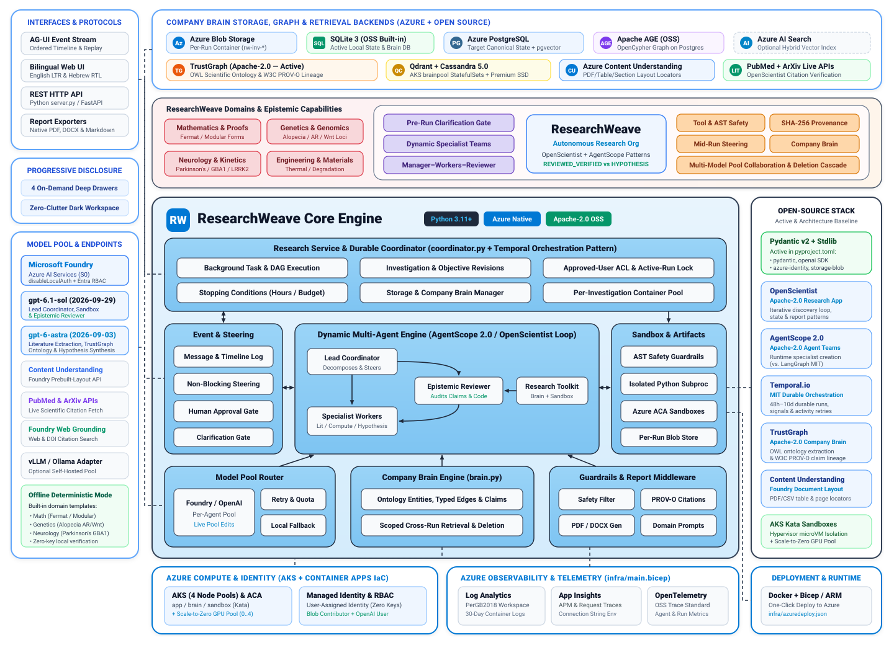

# ResearchWeave

**Autonomous Scientific & Engineering Research Platform on Microsoft Azure**

[](LICENSE)
[](https://portal.azure.com/#create/Microsoft.Template/uri/https%3A%2F%2Fraw.githubusercontent.com%2Froie9876%2Fresearchweave%2Fmain%2Finfra%2Fazuredeploy.json)

ResearchWeave is an open-source autonomous research organization in software with a clean, bilingual (**English / Hebrew RTL**) graphical workspace. Engineers and researchers can submit open-ended scientific, mathematical, or engineering problems—such as **Fermat's Last Theorem & modular generalizations**, **genetic hair loss (androgenetic alopecia) pathways**, or **Parkinson's disease (GBA1/α-synuclein) kinetics**—and let a dynamically assembled team of specialist agents investigate, run isolated calculations, connect evidence in a persistent **Company Brain**, and produce cited reports in **PDF, Word (`.docx`), and Markdown**.

---

## Key Capabilities

1. **Pre-Run Clarification & Confirmation Gate:** Before starting a multi-day or deep investigation, the Lead Research Coordinator asks domain-specific clarifying questions and presents the objective, model pool, and stopping conditions for confirmation.
2. **Dynamic Specialist Agent Creation:** Spawns domain-tailored specialist agents at runtime (literature explorer, quantitative sandbox analyst, hypothesis synthesizer, and an independent epistemic reviewer) and assigns models from the researcher's editable Azure Foundry model pool.
3. **Persistent Company Brain & Knowledge Graph:** Extracts entities, typed relationships, and source-linked claims with SHA-256 provenance. Enforces strict cross-investigation scope selection and propagates source deletions cleanly across derived graph nodes and claims.
4. **Epistemic Integrity (Verified Results vs. Hypotheses):** Automatically runs an Independent Reviewer Agent to separate verified calculations and source-backed observations (`REVIEWED_VERIFIED`) from unverified preclinical or theoretical hypotheses (`HYPOTHESIS`).
5. **Per-Investigation Azure Blob Container:** Automatically provisions an isolated container (`rw-inv-...`) per research run for uploaded datasets (`.csv`, `.txt`, `.md`) and generated calculation artifacts.
6. **Live Conversation & Non-Blocking Mid-Run Steering:** Converse with the Lead Research Coordinator while research is running. Ordinary questions are answered without interrupting workers; new directions record an Objective Revision within the same investigation and spawn a dedicated specialist branch.
7. **Progressive-Disclosure Bilingual Interface (EN / HE RTL):** Modern dark UI designed to prevent cognitive overload—showing core progress first and revealing deep agent graphs, Company Brain paths, Blob uploads, and live settings on demand.

---

## High-Level System Architecture & Layered Stack



### 1. Existing Open-Source Software & Frameworks Used

ResearchWeave combines lightweight, zero-lock-in Python building blocks in the runnable prototype (`src/researchweave/`) with source-verified open-source systems across its discovery loop, dynamic agent teams, durable coordination, and Company Brain layers:

| Layer | Open-Source Project / Package | License | Role in ResearchWeave (`src/` Runtime & Architecture Baseline) |
| :--- | :--- | :--- | :--- |
| **Data Validation & Schemas** | **[Pydantic v2](https://github.com/pydantic/pydantic)** | MIT | **Active in `pyproject.toml`:** Validates all investigation models, objective revisions, specialist personas, claims (`REVIEWED_VERIFIED` vs. `HYPOTHESIS`), and API payloads (`src/researchweave/models.py`). |
| **Azure Auth & Object SDKs** | **[azure-identity](https://github.com/Azure/azure-sdk-for-python)** & **[azure-storage-blob](https://github.com/Azure/azure-sdk-for-python)** | MIT | **Active in `pyproject.toml`:** Keyless `DefaultAzureCredential` authentication and per-investigation Blob container provisioning/uploads (`src/researchweave/blob_store.py`). |
| **Model Client SDK** | **[openai (Python SDK)](https://github.com/openai/openai-python)** | Apache-2.0 | **Active in `pyproject.toml`:** Standardized client interface for Microsoft Foundry / Azure OpenAI model pools (`AZURE_OPENAI_ENDPOINT`), paired with an offline deterministic domain engine for zero-key local runs. |
| **Embedded Durable State & Graph** | **[SQLite 3](https://www.sqlite.org/)** + **Python Stdlib (`http.server`, `ast`, `zipfile`)** | Public Domain / PSF | **Active in `src/`:** Thread-safe canonical store for investigations, entities, typed graph relations, and claims (`brain.py`), AST-inspected sandbox execution (`sandbox.py`), and dependency-free PDF/DOCX/Markdown generation (`reports.py`). |
| **Research Discovery Loop** | **[OpenScientist](https://github.com/openscientist-io/openscientist)** *(with Agent Zero & OpenHands evaluated)* | Apache-2.0 | **Application & Discovery Baseline:** Iterative scientific discovery loop, structured research state, hypothesis tracking, and report synthesis patterns adapted in `coordinator.py`. |
| **Dynamic Specialist Teams** | **[AgentScope 2.0](https://github.com/agentscope-ai/agentscope)** *(with LangGraph MIT compared)* | Apache-2.0 | **Multi-Agent Team Pattern:** Runtime-authored specialist agent roles (`Literature`, `Computation`, `Hypothesis`, `Independent Reviewer`) with dynamic model-pool assignment and Manager–Workers–Reviewer coordination. |
| **Durable Orchestration** | **[Temporal](https://github.com/temporalio/temporal)** + **Temporal Python SDK** | MIT | **Multi-Day Lifecycle Layer:** Target durable workflow engine for 48h–10d unattended runs, activity retries, and non-blocking live steering signals. |
| **Company Brain & Provenance** | **[TrustGraph](https://github.com/trustgraph-ai/trustgraph)**, **[LightRAG](https://github.com/HKUDS/LightRAG)**, **[Graphiti](https://github.com/getzep/graphiti)** | Apache-2.0 / MIT | **Knowledge Graph & Lineage:** OWL/RDF ontology extraction, PROV-O source provenance, contradiction preservation, and scoped cross-investigation graph traversal implemented in `brain.py`. |
| **Relational & Graph DB Scale-Out** | **[PostgreSQL](https://www.postgresql.org/)**, **[Apache AGE](https://age.apache.org/)**, **[pgvector](https://github.com/pgvector/pgvector)** | PostgreSQL / Apache-2.0 | **Target Production Store:** Canonical transactional store, OpenCypher graph queries (`Apache AGE`), and vector similarity baseline replacing local SQLite at scale. |
| **Document Parsing & UI Protocol** | **[Docling](https://github.com/docling-project/docling)**, **[AG-UI Protocol](https://github.com/ag-ui-protocol/ag-ui)**, **[OpenTelemetry](https://opentelemetry.io/)** | MIT / Apache-2.0 | **Ingestion, Streaming & Telemetry:** Structured PDF/table locator extraction (`Docling`), ordered agent-to-UI timeline event streaming (`AG-UI`), and vendor-neutral observability traces (`OpenTelemetry`). |

---

### 2. Microsoft Azure Services Used (Provisioned vs. Runtime vs. Scale-Out)

| Azure Service | Bicep Resource (`infra/main.bicep`) | Status in Repo | Why ResearchWeave Uses It |
| :--- | :--- | :--- | :--- |
| **Azure Container Apps** | `Microsoft.App/containerApps` & `managedEnvironments` | **Provisioned in IaC** | Hosts the ResearchWeave web workspace and API (port `8080`, 1–5 auto-scaling replicas) without AKS cluster management overhead. |
| **Azure Blob Storage** | `Microsoft.Storage/storageAccounts` | **Provisioned in IaC + Active in `blob_store.py`** | Automatically creates an isolated container (`rw-inv-<id>`) per investigation for uploaded datasets and generated artifacts with SHA-256 metadata (falls back to local disk when offline). |
| **Microsoft Foundry / Azure AI Services** | `Microsoft.CognitiveServices/accounts` (`AIServices`) | **Provisioned in IaC + Configured via Env** | Provides the enterprise model pool endpoint (`AZURE_OPENAI_ENDPOINT`) with `disableLocalAuth: true` so researchers can assign and live-switch models across specialists. |
| **User-Assigned Managed Identity & Azure RBAC** | `Microsoft.ManagedIdentity/userAssignedIdentities` | **Provisioned in IaC + Active via `DefaultAzureCredential`** | Keyless service-to-service authentication granting `Storage Blob Data Contributor` and `Cognitive Services OpenAI User` roles—zero API keys or connection strings in code. |
| **Azure Log Analytics & Application Insights** | `Microsoft.OperationalInsights/workspaces` & `Microsoft.Insights/components` | **Provisioned in IaC** | Captures container logs (30-day retention) and APM telemetry (`APPLICATIONINSIGHTS_CONNECTION_STRING`) separately from the user-facing research timeline. |
| **Azure Container Apps Sandboxes & Azure Batch** | *Target Scale-Out (`docs/`)* | **Architecture Target** *(Local AST subprocess active today)* | MicroVM-isolated dynamic code sessions for generated Python verification scripts, plus Azure Batch for heavy/GPU scientific workloads. |
| **Azure Database for PostgreSQL Flexible Server** | *Target Scale-Out (`docs/`)* | **Architecture Target** *(SQLite active today)* | Managed transactional database supporting `pgvector` and `Apache AGE` for multi-user production state and Temporal visibility. |

---

## One-Click Azure Deployment

Anyone can deploy their own instance of ResearchWeave into their own Azure subscription:

[](https://portal.azure.com/#create/Microsoft.Template/uri/https%3A%2F%2Fraw.githubusercontent.com%2Froie9876%2Fresearchweave%2Fmain%2Finfra%2Fazuredeploy.json)

### What the Template Provisions (`infra/main.bicep` & `infra/azuredeploy.json`)

- **User-Assigned Managed Identity** (`Microsoft.ManagedIdentity/userAssignedIdentities`) — zero hardcoded keys or passwords.
- **Azure Storage Account** (`Microsoft.Storage/storageAccounts`) — backs per-investigation Blob containers with `Storage Blob Data Contributor` RBAC.
- **Microsoft Foundry / Azure AI Services** (`Microsoft.CognitiveServices/accounts`) — model pool endpoint with `disableLocalAuth: true` and `Cognitive Services OpenAI User` RBAC.
- **Azure Container Apps Environment & App** (`Microsoft.App/containerApps`) — hosts the ResearchWeave web workspace and API.
- **Log Analytics & Application Insights** — operational telemetry.

### CLI Deployment Option

```bash
az group create --name rg-researchweave --location eastus2 --tags SecurityControl=Ignore
az deployment group create \
  --resource-group rg-researchweave \
  --template-file infra/main.bicep \
  --parameters appPrefix=rweave
```

---

## Quick Start (Local Run)

```bash
PYTHONPATH=src python3 -m researchweave.server
```

Then open **http://localhost:8080** in your browser.

### Running the Verification & Acceptance Suite

```bash
PYTHONPATH=src python3 -m unittest discover -s tests -v
```

---

## Architecture & Market Research Documentation

- [Source-Verified Market & Open-Source Study](docs/autonomous-research-market-study-2026-11-14.md)
- [Product Specification](docs/research-system-specification-draft.md)
- [System Architecture Proposal](docs/researchweave-architecture-proposal.md)
- [Company Brain Technical Design](docs/researchweave-company-brain-proposal.md)
- [Core Components & Integration Gates](docs/researchweave-core-components-proposal.md)
- [Security & Autonomous Guardrails](SECURITY.md)

## License

Licensed under the [Apache License 2.0](LICENSE).
